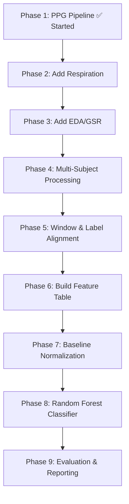

# 🧠 Complete Project Analysis — Plain English Explanation

## 1. What Is This Project About? (The Big Picture)

You are trying to **reproduce the signal-processing and machine-learning pipeline** described in a research paper, and then **test it on real physiological data**.

**The research paper** (Bian et al., 2019) built an adaptive VR driving simulator for teenagers with Autism Spectrum Disorder (ASD). The key idea was:

> *"Can we figure out whether someone is engaged or bored just by reading their body signals (heartbeat, skin sweat, breathing)? And if they're getting bored, can we automatically make the driving game harder to keep them interested?"*

**Your project** is NOT to rebuild the VR driving simulator. Instead, you are:
1. **Reproducing the data processing pipeline** — how they cleaned and processed body signals
2. **Reproducing the feature extraction** — how they turned raw signals into meaningful numbers
3. **Training a similar classifier** — using a Random Forest (a type of machine learning model)
4. **Testing it on the WESAD dataset** — a publicly available dataset with similar body signals

---

## 2. The Research Paper Explained (Bian et al., 2019)

### 2.1 What They Built: VDEAR System
- **VDEAR** = "VR-based Driving Environment with Adaptive Response technology"
- A driving simulator built in **Unity3D** with a **Logitech G27 steering wheel**
- Had **5 difficulty levels** that could be adjusted in real-time
- Difficulty was changed by modifying: brake responsiveness, accelerator feel, steering sensitivity, lighting, and traffic aggressiveness

### 2.2 How They Measured Body Signals
They used a **BIOPAC MP150** system (professional medical-grade equipment) recording at **1,000 samples per second**. They measured 3 things:

| Signal | What It Measures | Where Placed |
|--------|-----------------|-------------|
| **PPG** (Photoplethysmogram) | Blood flow / heartbeat | Middle toe of left foot |
| **GSR** (Galvanic Skin Response) | Skin sweat / electrical conductivity | Toes of left foot |
| **RSP** (Respiration) | Breathing pattern | Belt around abdomen |

> [!IMPORTANT]
> They put sensors on the **toes** (not the wrist) to avoid interference from steering wheel movement. This is very different from WESAD, which uses a **wrist device**.

### 2.3 How They Cleaned the Signals (Preprocessing)
Raw body signals are messy — they contain noise from electricity, body movement, etc. Here's what they did:

1. **Removed outlier spikes** (sudden crazy jumps in the data) and filled gaps with nearby average values
2. **Applied a 60 Hz Notch filter** — to remove electrical noise from power outlets (US uses 60 Hz electricity)
3. **Applied signal-specific bandpass filters**:
   - **PPG**: Kept only frequencies between **1.1 Hz and 3.6 Hz** (the heartbeat range, ~66-216 beats per minute)
   - **Respiration**: Kept only **0.05 Hz to 0.35 Hz** (the breathing range, ~3-21 breaths per minute)
   - **GSR**: Low-pass at **0.5 Hz** (skin conductance changes slowly); then separated into **tonic** (baseline level) and **phasic** (event-triggered responses) components
4. **Downsampled from 1,000 Hz to 100 Hz** to speed up computation

### 2.4 The 10 Features They Extracted
Every **3 minutes** of data was compressed into **10 numbers**:

| # | Signal | Feature | What It Means in Plain English |
|---|--------|---------|-------------------------------|
| 1 | PPG | Mean HRV | Average variation in time between heartbeats (higher = more relaxed) |
| 2 | PPG | Mean peak amplitude | Average strength of each heartbeat pulse (in microvolts) |
| 3 | RSP | Mean amplitude | Average size of breathing movements |
| 4 | RSP | Std dev of amplitude | How consistent/variable the breathing depth is |
| 5 | RSP | Subband spectral entropy | How "regular" or "chaotic" the breathing pattern is (0.05–0.35 Hz band) |
| 6 | RSP | Mean peak-valley magnitude | Average difference between inhale peak and exhale valley |
| 7 | RSP | Std dev of peak-valley magnitude | Variability in that breath-to-breath difference |
| 8 | GSR | Rate of phasic activity | How many sweat response spikes per second |
| 9 | GSR | Std dev of tonic activity | Variability in the baseline skin conductance level |
| 10 | GSR | Slope of tonic activity | Is the baseline sweat level going up or down over time? |

### 2.5 The Engagement Labels (Ground Truth)
- A **trained clinical observer** watched each participant and rated their engagement on a **1-9 scale** every **3 minutes**
- These ratings were converted to **binary labels**: "High Engaged" or "Low Engaged"
- The inter-rater reliability was **0.9** (very good agreement between two observers)

### 2.6 The Machine Learning Model
They tested 6 different classifiers:

| Algorithm | Accuracy |
|-----------|----------|
| Random Forest | **84.72%** ← Winner |
| Multilayer Perceptron | 81.94% |
| J48 Decision Tree | 80.37% |
| SVM | 80.67% |
| Naive Bayes | 75.93% |
| BayesNet | 72.95% |

**Random Forest settings**: 100 trees, unlimited depth, evaluated with **grouped 10-fold cross-validation** (keeping all windows from one person in the same fold to prevent data leakage).

### 2.7 How The Adaptation Loop Worked
Every 3 minutes, the system:
1. Collected 3 min of physiological data
2. Subtracted baseline features (from a 3-min calm baseline at the start)
3. Fed the 10 features into the Random Forest model
4. Got a prediction: "High Engaged" or "Low Engaged"
5. Combined this with driving performance ("Good" or "Poor")
6. Decided whether to increase, decrease, or keep the same difficulty level

### 2.8 Results
- 20 of 23 ASD teenagers completed the study (3 excluded due to equipment issues)
- The **engagement-sensitive (ES) group** reported higher enjoyment and liked the difficulty adjustment more than the **performance-only (PS) group**
- ES group had statistically significantly higher engagement levels
- Driving performance was similar between groups

---

## 3. The WESAD Dataset You're Using

### 3.1 What Is WESAD?
- **WESAD** = "Wearable Stress and Affect Detection"
- Published by Schmidt et al. (2018) at ACM ICMI conference
- **15 subjects** (17 recorded, 2 excluded due to sensor failure)
- A **lab study** involving controlled emotional conditions

### 3.2 What Conditions Were in the Study?

| Label | Condition | What Happened |
|-------|-----------|--------------|
| 0 | Undefined/Transient | Transitions between conditions (ignore these) |
| 1 | **Baseline** | Sitting calmly, neutral state |
| 2 | **Stress** | Trier Social Stress Test (public speaking + mental arithmetic) |
| 3 | **Amusement** | Watching funny video clips |
| 4 | **Meditation** | Guided breathing/relaxation |
| 5,6,7 | Other | Should be ignored per the dataset README |

### 3.3 What Sensors Were Used?

**Wrist Device — Empatica E4:**
| Channel | Rate | What It Measures |
|---------|------|-----------------|
| BVP (PPG) | **64 Hz** | Blood volume pulse (heartbeat from wrist) |
| EDA | **4 Hz** | Skin conductance (sweat) |
| TEMP | 4 Hz | Skin temperature |
| ACC | 32 Hz | Wrist acceleration/movement |

**Chest Device — RespiBAN:**
| Channel | Rate | What It Measures |
|---------|------|-----------------|
| ECG | 700 Hz | Heart electrical signal (gold standard) |
| EDA | 700 Hz | Chest skin conductance |
| EMG | 700 Hz | Muscle activity |
| RESP | **700 Hz** | Breathing pattern |
| TEMP | 700 Hz | Body temperature |
| ACC | 700 Hz | Chest acceleration |

### 3.4 Data Format
Each subject's data is stored as a Python **pickle file** (e.g., `S2.pkl`). Inside:
```
data['signal']['wrist']['BVP']   → wrist PPG at 64 Hz
data['signal']['wrist']['EDA']   → wrist skin conductance at 4 Hz
data['signal']['chest']['Resp']  → chest breathing at 700 Hz
data['label']                    → condition labels for each sample
```

---

## 4. Key Differences Between the Paper and WESAD

> [!WARNING]
> These differences are critical. You **cannot** claim your WESAD model is the same as the paper's model.

| Aspect | Original Paper | WESAD |
|--------|---------------|-------|
| **Task** | VR driving simulation | Sitting through stress/relaxation protocols |
| **PPG location** | Toe | Wrist |
| **PPG sample rate** | 1,000 Hz → downsampled to 100 Hz | 64 Hz (native) |
| **GSR location** | Toe | Wrist (4 Hz) or Chest (700 Hz) |
| **Labels** | "High Engaged" / "Low Engaged" | Baseline / Stress / Amusement / Meditation |
| **Ground truth source** | Clinical observer ratings | Protocol phase labels |
| **Participants** | 20 ASD teenagers | 15 healthy adults |
| **Recording system** | BIOPAC MP150 | Empatica E4 + RespiBAN |
| **60 Hz notch filter** | Yes (needed for BIOPAC) | **No!** (wrist BVP is only 64 Hz, Nyquist is 32 Hz) |

---

## 5. What Your Current Code Does

Your [ppg_wesad_pipeline.py](file:///d:/PRJ/ppg_wesad_pipeline.py) handles **only the PPG/BVP channel from one subject (S2)**. Here's what it does step by step:

### Step 1: Load Data (Lines 76-112)
Loads `S2.pkl` and extracts `data['signal']['wrist']['BVP']` as a 1D numpy array.

### Step 2: Inspect Raw Signal (Lines 118-169)
Prints statistics (min, max, mean, std, percentiles) and saves full + zoomed plots of the raw BVP.

### Step 3: Compare Filters (Lines 194-237)
Tests 4 different bandpass filters on the same data and plots them side by side:
- 0.5–4 Hz
- 0.7–4 Hz
- 1.1–3.6 Hz (paper's setting)
- 0.5–8 Hz

### Step 4: Flag Outliers (Lines 243-286)
Uses robust statistics (MAD = Median Absolute Deviation) to flag extreme values. **Does NOT delete anything** — just highlights suspicious points for you to review.

### Step 5: Detect Peaks (Lines 292-338)
Uses scipy's `find_peaks()` with heuristic settings to find heartbeat peaks in the filtered signal. Plots them for visual verification.

### Step 6: Extract Features (Lines 344-416)
In each 3-minute (180-second) window, calculates:
- **Mean IBI** (inter-beat interval) in milliseconds — a proxy for HRV
- **Mean pulse amplitude** — peak height minus the trough before it

### Step 7: Save Everything (Lines 422-435)
Saves raw signal, filtered signal, peak indices, and feature CSV.

> [!NOTE]
> The current pipeline is PPG-only, single subject, and has no engagement labels. It correctly leaves `engagement_label` as NaN because WESAD doesn't have the paper's engagement labels.

---

## 6. What Still Needs to Be Done (The Full Roadmap)

Based on your project plans, here's the complete journey ahead:



### What Each Phase Involves:

| Phase | Task | Status |
|-------|------|--------|
| 1. PPG/BVP | Filter, detect peaks, extract mean IBI + amplitude | 🟡 Code exists, needs validation |
| 2. Respiration | Load chest RESP at 700 Hz, filter 0.05–0.35 Hz, extract 5 features | ❌ Not started |
| 3. EDA/GSR | Load wrist EDA at 4 Hz, decompose tonic/phasic, extract 3 features | ❌ Not started |
| 4. Multi-subject | Process all 15 subjects, not just S2 | ❌ Not started |
| 5. Alignment | Map 180-sec windows to WESAD labels (stress/baseline/etc.) | ❌ Not started |
| 6. Feature table | Create CSV: 1 row per subject-window, 10 features + labels | ❌ Not started |
| 7. Normalization | Subtract each subject's baseline features from their later windows | ❌ Not started |
| 8. Classifier | Train Random Forest with subject-wise cross-validation | ❌ Not started |
| 9. Report | Document everything, compare with paper, state limitations | ❌ Not started |

---

## 7. Important Technical Details You Should Know

### 7.1 Why 3-Minute Windows?
The paper used 3-minute windows because:
1. Physiological signals (especially skin conductance) change slowly — you need enough time to see a real pattern
2. The clinical psychologists agreed that 3 minutes is enough time for someone to feel engaged or disengaged

### 7.2 What Is Baseline Normalization?
Before each experiment, participants sat still for 3 minutes. The features from this "calm" period were subtracted from all later features. This removes individual differences (some people naturally sweat more, have faster heartbeats, etc.) and highlights what *changed* during the task.

### 7.3 Why Subject-Wise Cross-Validation?
If you randomly mix windows from all subjects, a model might "cheat" by learning Subject #3's heartbeat pattern rather than learning what stress actually looks like. **Grouped/subject-wise validation** ensures that all of one person's data stays together — either entirely in training or entirely in testing. This tests whether the model can generalize to *new people*.

### 7.4 What Can You Claim vs. What You Cannot

✅ **Can claim:**
- Built a reproducible pipeline inspired by the paper
- Evaluated Random Forest on WESAD stress/affect labels
- Analyzed how wrist BVP, respiration, and EDA features behave across conditions

❌ **Cannot claim:**
- That your model predicts "engagement" (WESAD has stress labels, not engagement labels)
- That your model is the same as the paper's model
- That WESAD wrist BVP amplitude is in microvolts
- That stress classification proves effectiveness for ASD driving training

---

## 8. Available Data in Your WESAD Directory

You have **15 subjects**: S2, S3, S4, S5, S6, S7, S8, S9, S10, S11, S13, S14, S15, S16, S17

Each subject folder contains:
- `Sx.pkl` — The main data file (~1 GB) with all sensor data and labels
- `Sx_E4_Data.zip` — Raw Empatica E4 CSV exports
- `Sx_quest.csv` — Questionnaire responses (PANAS, STAI, DIM, SSSQ)
- `Sx_readme.txt` — Demographics (age, height, weight, gender, etc.)
- `Sx_respiban.txt` — Raw RespiBAN text data

---

## 9. Current Code Issues / Things to Watch Out For

1. **DATA_FILE path is wrong** in [ppg_wesad_pipeline.py](file:///d:/PRJ/ppg_wesad_pipeline.py#L45): It points to `D:\Datasets\WESAD\S2\S2.pkl` but your actual data is at `D:\PRJ\WESAD\WESAD\S2\S2.pkl`
2. **No engagement labels exist in WESAD** — the code correctly marks them as NaN, but you'll need to switch to WESAD's actual labels (stress/baseline/etc.) for model training
3. **Filter comparison needs visual review** — the code generates the comparison plots, but someone needs to actually look at them and decide which filter is best for WESAD's wrist BVP
4. **Mean IBI ≠ Mean HRV** — the code calculates mean inter-beat interval, but the paper says "mean of heart rate variability." These might not be exactly the same thing. You need to decide on a precise definition.
5. **Only processes S2** — needs to be extended to loop over all 15 subjects
6. **No Respiration or EDA features yet** — you need 8 more features to match the paper's 10
